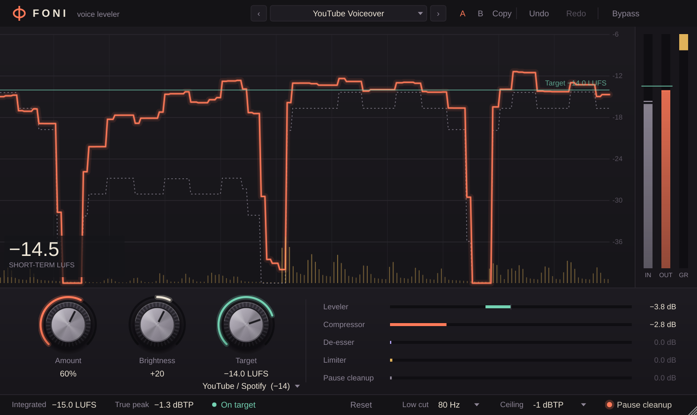

# FONI — free voice leveler & finisher

FONI is a voice leveler and finisher plugin for podcast, YouTube and streaming.
Three knobs (Amount, Brightness, Target) and it lands your voice on the loudness each platform expects:
Apple Podcasts −16 LUFS, YouTube/Spotify −14, Speech −18, Broadcast −23.

**Website:** https://revolver-audio.github.io/foni-plugin/

## Download (0.9.0 beta, free)

| System | Installer | Formats |
| --- | --- | --- |
| Windows 10/11 x64 | [FONI-0.9.3-Windows-Setup.exe](downloads/FONI-0.9.3-Windows-Setup.exe) | VST3, CLAP, Standalone |
| macOS 11+ (Apple Silicon & Intel) | [FONI-0.9.3-macOS.pkg](downloads/FONI-0.9.3-macOS.pkg) | VST3, AU, CLAP, Standalone |

\* AAX loads in Pro Tools once the plugin is signed (coming in a later release).

The installers are not code-signed yet:
- **Windows:** if SmartScreen appears, click *More info → Run anyway*.
- **macOS:** if the installer is blocked, open *System Settings → Privacy & Security* and click *Open Anyway*.

## Feedback

Found a bug or have an idea? [Open an issue](../../issues) or email revolveraudio.skg@gmail.com.

© 2026 Revolver Audio. FONI is free to use for personal and commercial productions; redistribution is not allowed.
VST is a trademark of Steinberg Media Technologies GmbH. AAX and Pro Tools are trademarks of Avid Technology, Inc.
